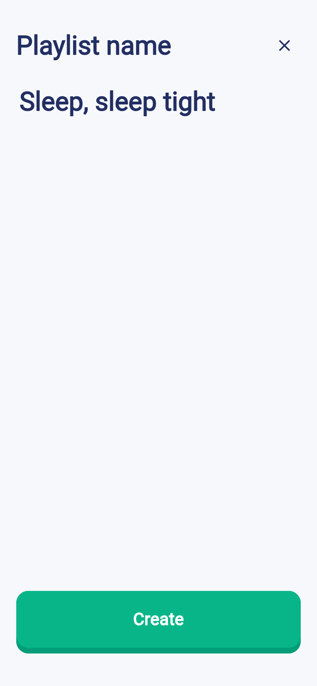
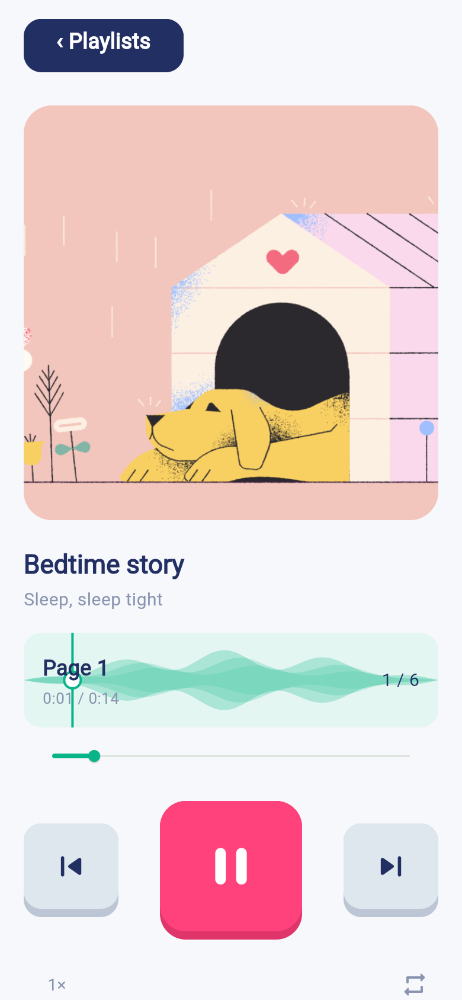
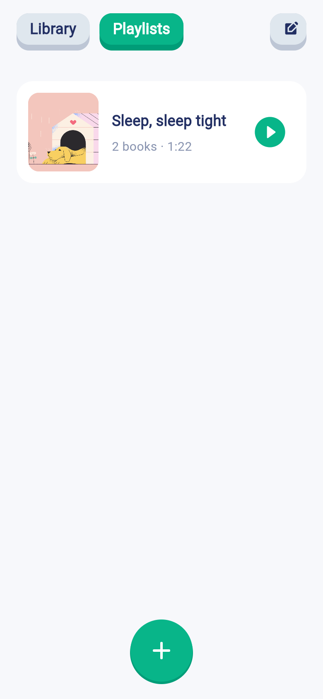
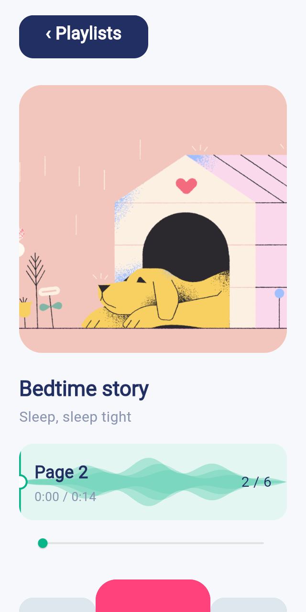

# 界面截图

运行截图来自 Flutter Web release 构建，主视口 390 × 844 @2x。Pixso 原稿为 375 × 812；导出时透明背景合成为浅色底，以便查看。

相机页面为 App 内封面入口与导入照片后的预览；系统相机的具体界面取决于设备。录音使用合成音频流，编码、持久化与播放执行真实插件流程。

## 全部主要界面

### 01 · 首次引导

[查看运行图](screenshots/01-welcome.png) · [查看 Pixso 原稿](reference/01-welcome.png) · 节点 `0:468`

### 02 · 新建书籍

[查看运行图](screenshots/02-new-book.png) · [查看 Pixso 原稿](reference/02-new-book.png) · 节点 `0:458`

### 03 · 录音中

[查看运行图](screenshots/03-recording.png) · [查看 Pixso 原稿](reference/03-recording.png) · 节点 `0:439`

### 04 · 录音停止与回听入口

[查看运行图](screenshots/04-recording-stop.png) · [查看 Pixso 原稿](reference/04-recording-stop.png) · 节点 `0:418`

### 05 · 录音回听

[查看运行图](screenshots/05-recording-listen.png) · [查看 Pixso 原稿](reference/05-recording-listen.png) · 节点 `0:386`

### 06 · 封面拍摄入口

[查看运行图](screenshots/06-camera.png) · [查看 Pixso 原稿](reference/06-camera.png) · 节点 `0:375`

### 07 · 封面确认

[查看运行图](screenshots/07-camera-check.png) · [查看 Pixso 原稿](reference/07-camera-check.png) · 节点 `0:360`

### 08 · 书籍内容

[查看运行图](screenshots/08-book-content.png) · [查看 Pixso 原稿](reference/08-book-content.png) · 节点 `0:341`

### 09 · 页面编辑菜单

[查看运行图](screenshots/09-page-edit.png) · [查看 Pixso 原稿](reference/09-page-edit.png) · 节点 `0:318`

### 10 · 双列书库

[查看运行图](screenshots/10-library-grid.png) · [查看 Pixso 原稿](reference/10-library-grid.png) · 节点 `0:262`

### 11 · 单列书库

[查看运行图](screenshots/11-library-list.png) · [查看 Pixso 原稿](reference/11-library-list.png) · 节点 `0:231`

### 12 · 书库编辑选择

[查看运行图](screenshots/12-library-edit.png) · [查看 Pixso 原稿](reference/12-library-edit.png) · 节点 `0:164`

### 13 · 播放列表空状态

[查看运行图](screenshots/13-playlists-empty.png) · [查看 Pixso 原稿](reference/13-playlists-empty.png) · 节点 `0:145`

### 14 · 播放列表命名

[查看运行图](screenshots/14-playlist-name.png) · [查看 Pixso 原稿](reference/14-playlist-name.png) · 节点 `0:137`

### 15 · 选择书籍

[查看运行图](screenshots/15-choose-books.png) · [查看 Pixso 原稿](reference/15-choose-books.png) · 节点 `0:82`

### 16 · 勾选书籍

[查看运行图](screenshots/16-choose-books-selected.png) · [查看 Pixso 原稿](reference/16-choose-books-selected.png) · 节点 `0:26`

### 17 · 播放器播放

[查看运行图](screenshots/17-player-playing.png) · [查看 Pixso 原稿](reference/17-player-playing.png) · 节点 `0:14`

### 18 · 播放器暂停

[查看运行图](screenshots/18-player-paused.png) · [查看 Pixso 原稿](reference/18-player-paused.png) · 节点 `0:2`

## 补充界面

| 已创建的播放列表 | 320 × 640 小屏播放器 | 768 × 1024 宽屏播放器 |
| --- | --- | --- |
|  |  |  |
