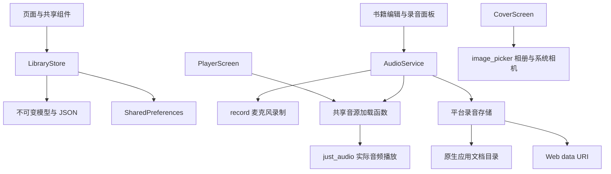

# KidBook 项目说明

KidBook 是一款亲子有声书 Flutter App：家长为每一页录制自己的声音，配上封面，整理成书籍和播放列表，让孩子随时听熟悉的声音讲故事。

本项目读取了 Pixso「Design」页的 18 个画面，使用原稿插画作为本地资源。界面沿用深蓝文字、薄荷绿波形、绿色立体按钮、粉色播放键与大圆角。原稿根画板没有背景填充，运行界面采用其顶部栏和插画渐变中的浅灰底色 `#F7F8FB`。主要 UI 文案保留原稿英文。

## 主要界面

以下图片来自**运行中的 Flutter Web release 构建**，移动视口为 390 × 844，设备像素比为 2。拍照入口交给设备系统相机；浏览器验证使用照片导入，录音验证使用合成麦克风音频流，实际执行 MediaRecorder 编码、保存及播放。

| 第一次打开 | 书库 |
| --- | --- |
|  |  |

| 编辑一本书 | 录制一页 |
| --- | --- |
|  |  |

| 选择播放列表中的书 | 播放器 |
| --- | --- |
|  |  |

完整图片见 [界面截图索引](界面截图.md)，原稿导出文件放在 `reference/`，设计节点和实现模块的对应关系见 [design-map.json](design-map.json)。

## 已实现的流程

1. **首次使用**：创建第一本书，或主动导入 6 本示例故事。示例包含本地英文朗读音频，无需联网。
2. **书库**：双列封面、单列大卡片、点击播放/编辑、长按进入选择、批量删除。删除书籍时会同步移除播放列表里的引用。
3. **书籍编辑**：输入书名、选插画封面、相册导入、移动端相机拍照；添加多页录音、回听、重录、改名、删除、长按拖动排序；保存前校验书名和内容。退出有改动的草稿时提示保留或丢弃。
4. **录音**：准备 → 录音 → 停止 → 回听 → 保存为一页；显示计时和动态波形。麦克风不可用时显示原因，关闭录音面板会取消录制并清理未保存的文件。
5. **播放列表**：命名、多选书籍、保存、重新选择、改名、删除；按选定书籍及其页序连续播放。
6. **播放器**：播放/暂停、前后翻页、进度拖动、0.75/1/1.25/1.5 倍速、循环播放。音频由播放器实际加载和播放，进度来自音频流。
7. **持久化**：保存的书籍、页名、页序、封面、录音、播放列表可在重启后恢复。

原稿中的 18 张图对应同一组页面的不同状态，代码用页面和状态机复用这些状态。为适配操作，页编辑采用菜单和长按排序；拍照使用系统能力，封面确认使用 App 内预览。新增的示例入口、书名输入提示、错误反馈、播放进度和辅助按钮用于让静态设计形成完整产品流程。

## 项目结构

```text
KidBook/
├── lib/
│   ├── main.dart                    # 初始化 Flutter、系统栏和本地书库
│   ├── app.dart                     # MaterialApp、主题入口、宽屏最大宽度
│   ├── core/
│   │   └── theme.dart               # 颜色、文字、输入框等视觉规则
│   ├── data/
│   │   ├── models.dart              # Book / StoryPage / StoryPlaylist + JSON
│   │   └── library_store.dart       # 书库状态、持久化、引用维护、示例数据
│   ├── services/
│   │   ├── audio_service.dart       # 录音、播放、音源解析
│   │   ├── media_files.dart         # 条件导出的统一入口
│   │   ├── media_files_native.dart  # 原生录音路径和文件清理
│   │   └── media_files_web.dart     # Web 录音转为持久化 data URI
│   ├── widgets/
│   │   └── common.dart              # 按钮、封面、波形、音频页、公共弹窗
│   └── features/
│       ├── library/library_screen.dart
│       ├── books/book_editor.dart
│       ├── books/cover_screen.dart
│       ├── books/recording_sheet.dart
│       ├── playlists/playlist_screens.dart
│       └── player/player_screen.dart
├── assets/
│   ├── images/                      # 7 张从 Pixso 导出的插画
│   └── audio/                       # 3 段本地示例朗读
├── test/
│   ├── library_store_test.dart      # 数据、持久化和引用关系测试
│   └── widget_test.dart             # 操作流程、校验和多尺寸布局测试
├── tool/
│   ├── serve.cjs                    # 本地 release 预览服务
│   └── browser_smoke.cjs            # 浏览器流程验收和截图
├── docs/
│   ├── 项目说明.md
│   ├── 界面截图.md
│   ├── design-map.json
│   ├── reference/                   # 18 张原稿图
│   └── screenshots/                 # App 运行截图
├── android/                         # Android 工程和麦克风权限
├── ios/                             # iOS 工程和隐私用途说明
├── macos/                           # macOS 工程、录音与文件选择权限
├── web/                             # Web 宿主和 manifest
└── pubspec.yaml / pubspec.lock       # 依赖声明与可复现的版本锁定
```

## 架构与数据流

采用按功能组织的轻量分层。`StatefulWidget` 管理页面草稿、录音状态和选择状态；`LibraryStore extends ChangeNotifier` 管理已保存的数据，通过 `ListenableBuilder` 更新书库。小型离线 App 使用 Flutter 自带的状态机制，避免再引入全局状态或路由框架。



数据写入成功后才发布新的书库状态。编辑器先维护独立草稿，保存时提交完整 `Book`；丢弃草稿会删除该草稿新增的原生录音文件。删除书籍后再清理录音，内置示例音频不参与文件删除。

| 模型 | 核心字段 | 关系 |
| --- | --- | --- |
| `Book` | `id`、`title`、`cover`、`pages` | 书籍拥有有序的录音页 |
| `StoryPage` | `id`、`title`、`audio`、`seconds` | 一页对应一段真实音频 |
| `StoryPlaylist` | `id`、`title`、`bookIds` | 保存书籍 ID，避免复制内容 |

书库以版本化 JSON 存入 `kidbook.library.v1`。原生录音为文档目录下的 `.m4a` 文件；Web 录音为 `audio/webm` data URI，刷新后仍然可播放。照片缩放到不超过 1000 × 1000，并保存为 data URI。读取损坏或未知版本数据时保留原值并显示错误。

## 平台和依赖

使用 Flutter 3.41.6、Dart 3.11.4，依赖实际锁定在 `pubspec.lock`。

| 依赖 | 用途 |
| --- | --- |
| [record 6.2.1](https://pub.dev/packages/record/versions/6.2.1) | 麦克风录音，原生 AAC / Web Opus |
| [just_audio 0.10.6](https://pub.dev/packages/just_audio/versions/0.10.6) | 本地资源、录音文件和 Web 音频播放 |
| [image_picker 1.2.4](https://pub.dev/packages/image_picker/versions/1.2.4) | 相册导入和移动端系统相机 |
| shared_preferences 2.5.6 | 书籍与播放列表元数据 |
| path_provider 2.1.6 | 原生应用文档目录 |

Android 配置 `RECORD_AUDIO`；iOS 配置麦克风、相机和相册用途说明；macOS 配置音频输入、相机及用户选择文件的沙箱权限。移动端相机由系统页面完成拍摄，桌面端使用文件选择。浏览器录音需要 localhost 或 HTTPS，权限由浏览器管理。

## 运行与验收

```sh
flutter pub get
flutter run -d chrome
flutter run -d macos
flutter run -d <Android 或 iOS 设备 ID>
```

首次打开点击 **Explore sample library**，即可体验原稿插画书库。新建书籍时，至少输入书名并录制一页，然后点右上角 **Save**。

```sh
flutter analyze
flutter test
flutter build web --release
flutter build apk --release --target-platform android-arm64
```

浏览器流程和截图的复现步骤见 [README](../README.md)。脚本使用全新、独立的浏览器上下文，不读取日常浏览器中的书库。

## 验证记录与边界

验证日期：2026-10-24。

- 静态分析：`flutter analyze` 通过，无问题。
- 自动化：11 项 Flutter 测试通过，覆盖示例导入幂等、持久化恢复、编辑页序、删除引用清理、损坏数据保留、表单校验、播放列表创建以及 320/390/768 三种宽度。
- 浏览器：完整流程验收通过，生成 21 张运行截图，未捕获到未处理异常；验证了录音编码、保存后刷新与再次播放、照片导入、播放列表、翻页、自动续播和循环设置。详细记录见 [browser-test-result.json](browser-test-result.json)。
- 构建：Web release 和 Android debug APK 已成功构建；Android arm64 release APK 构建成功，约 20.1 MB，位于 `build/app/outputs/flutter-apk/app-release.apk`。该包用于本地验收，采用模板调试签名，正式发布时需配置发布签名。
- 模拟器：本机 Android AVD 的系统镜像文件缺失，iOS 模拟器运行时不可用，因此本次没有把截图标注为模拟器截图。
- 浏览器验收使用合成麦克风音频流与照片文件；移动设备上的实体麦克风、系统相机授权及后台行为仍需在设备上复核。

当前为本地优先的前台 App。Web 本地存储适合短录音，长时间录音可能达到浏览器配额；保存失败会反馈错误。尚未加入账号、云同步、后台音频、锁屏控制或录音导出。字体使用可跨平台运行的 Arial/系统回退，和原稿 SF UI Display 有字形差异。示例朗读由 macOS 系统语音合成，仅用于验证试听流程。

## 代码精简

统一使用主题色和公共按钮、封面、音频页、波形组件；18 个设计状态由少量页面和状态管理实现。复用同一套音源加载逻辑和 JSON 模型，平台差异仅保留在录音存储适配文件。移除了 Flutter 计数器示例、未使用的图片和图标包、Pixso 导出辅助代码、无用变量与重复逻辑，并保留测试与版本锁文件。
